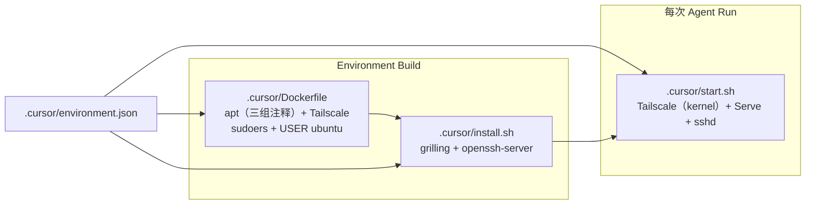
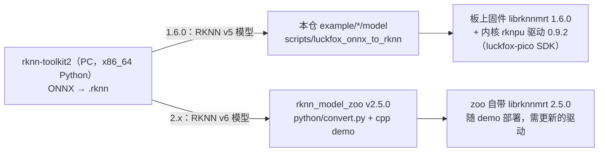
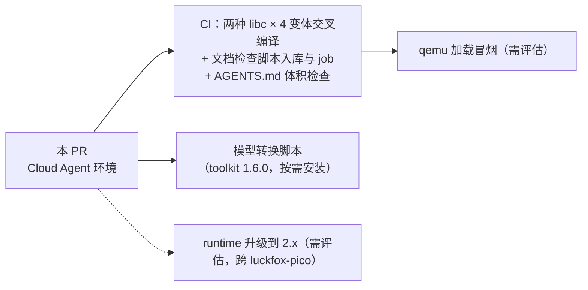

# Luckfox Pico RKNN Example — Cloud Agent 环境设计规格

- **日期**：2026-11-27
- **状态**：已落地，V1–V4 本机验证通过，V5、V6 待作者在 Cursor 中验证，验证证据见 plan
- **分支**：`pi/cloudagent-env`（起点 `origin/dev` `16ef54a`，与上游 `LuckfoxTECH/luckfox_pico_rknn_example` 的 `kernel-5.10.160` 相同），PR [#1](https://github.com/yuangezhizao/luckfox_pico_rknn_example/pull/1)
- **范围来源**：作者要求为本仓补充 Cursor Cloud Agent 运行所需的文件，参考 luckfox_pico_rkmpi_example（下称 rkmpi 仓）[PR #1](https://github.com/yuangezhizao/luckfox_pico_rkmpi_example/pull/1) 与 luckfox_pico_lvgl_example（下称 lvgl 仓）PR [#1](https://github.com/yuangezhizao/luckfox_pico_lvgl_example/pull/1)–[#3](https://github.com/yuangezhizao/luckfox_pico_lvgl_example/pull/3)、[#9](https://github.com/yuangezhizao/luckfox_pico_lvgl_example/pull/9)，优先参考 rkmpi 仓（最新）
- **参考实现**：rkmpi 仓 [`dev` `cf2a0db`](https://github.com/yuangezhizao/luckfox_pico_rkmpi_example/tree/cf2a0dbb99416858454bef9f9108a028362e75d9)（PR [#2](https://github.com/yuangezhizao/luckfox_pico_rkmpi_example/pull/2) 合入）。`.cursor/` 6 个文件、根 `AGENTS.md`、`docs/superpowers/AGENTS.md` 由 rkmpi 仓 PR #1 从 lvgl 仓 `dev` `11497f3` 移植而来，PR #2 启用了 `python3-markdown-it` 并更新了 CI 相关说明（§2.2）
- **关联计划**：[`../plans/2026-11-27-rknn-example-cloudagent-env.md`](../plans/2026-11-27-rknn-example-cloudagent-env.md)

---

## 1. 概述与目标

本仓是 Luckfox 官方的 RKNN 例程集：3 个例程（4 个构建变体）用 RKNN 与 OpenCV-Mobile 做人脸识别、目标检测，结果显示在 SPI / RGB 屏或终端，C++ + CMake 构建，产物是 32 位 ARM（RV1103 / RV1106），只能交叉编译。Cursor Cloud Agent 的默认镜像没有 ARM 交叉工具链；rkmpi 仓与本仓结构几乎相同（同为 Luckfox 例程集、同一套 `build.sh` / `CMakeLists.txt` 写法、同样两种 libc），其 Cloud Agent 环境可以近乎原样移植。

目标：

1. 把 rkmpi 仓 `dev` 的 Cloud Agent 环境移植到本仓：两份 Dockerfile（非注释部分与 rkmpi 仓 `dev` 相同，Q2）、`environment.json`、`install.sh`、`start.sh`、`.cursor/AGENTS.md`（§3.2、§3.3）。
2. 新增根 `AGENTS.md` 与 `docs/superpowers/AGENTS.md`，结构与 rkmpi 仓相同、内容按本仓改写，写明模型转换的版本约束（§3.4、Q3）。
3. Tailscale 主机名区分项目：`cursor-agent-for-luckfox-pico-rknn-example-<bcId 前 8 位>`（§3.3）。
4. 在当前 VM 临时安装 Docker，构建两份镜像，完成两种 libc × 4 个变体的交叉编译；平台侧验证留到下一个 PR（§4、Q4）。

**不在本规格范围**：CI、文档检查脚本入库（下一个 PR，Q1）；模型转换环境（Q3）；修改 `CMakeLists.txt`、`build.sh`、例程源码与 `install/`；uClibc 工具链预装；板上 RKNN runtime 升级（§2.8）。

## 2. 背景

### 2.1 本仓现状（2026-11-27）

| 方面 | 现状 |
|---|---|
| 例程 | `luckfox_pico_retinaface_facenet`（RetinaFace + FaceNet 人脸识别，RGB 屏 `/dev/fb0`）、`luckfox_pico_retinaface_facenet_spidev`（同上，SPI 屏 Pico-ResTouch-LCD，按板型分 `-DLUCKFOX_PICO_PLUS=ON`、`-DLUCKFOX_PICO_PRO_MAX=ON` 两个变体，只影响 SPI 速率）、`luckfox_pico_yolov5`；每种 libc 4 个构建变体 |
| 构建入口 | `build.sh` 用 `select` 交互选择 libc、例程，spidev 再选板型，在仓库内 `build/` 中 `cmake` 后 `make -j install`；`build.sh clean` 删除 `build/` 与整个 `install/` |
| 工具链 | 与 rkmpi 仓相同：uClibc 取 `$LUCKFOX_SDK_PATH/tools/linux/toolchain/arm-rockchip830-linux-uclibcgnueabihf/`，glibc 取 `$GLIBC_COMPILER` 前缀；未设置时 `CMakeLists.txt` 打印 WARNING 后 `return()` |
| 依赖 | OpenCV-Mobile、`librknnmrt` 按 libc 预编译于 `lib/{glibc,uclibc}`（各 17 MB）；`lib/` 下另有 Waveshare 屏驱动源码 `Config/` `GPIO/` `GUI/` `LCD/` `SPI/`；`3rdparty/` 有 librga、jpeg_turbo、stb_image、allocator（13 MB）；头文件在 `include/`。无需系统库 |
| 产物 | `CMAKE_INSTALL_PREFIX` 在 `project()` 之后用 `set()` 写死为源码树内 `install/<libc>/<例程>[_plus\|_pro_max]_demo/`，**而 `install/` 已入库**（65 MB，8 个部署目录），`make install` 会改写已跟踪的二进制（§2.3）；部署目录含可执行文件、`lib/librga.so`、`model/` |
| 模型转换 | `scripts/luckfox_onnx_to_rknn/`（70 MB）：`convert.py` 依赖 RKNN-Toolkit2，`sim/` 为模拟器测试脚本；含 ONNX 与 RKNN 模型（§2.7） |
| 运行 | 只能在板上运行：例程启动即 `system("RkLunch-stop.sh")`，再打开摄像头、NPU 与屏幕；`doc/` 是 Rockchip RKNN SDK 1.6.0 的 PDF |
| Agent 文件 | 无 `.cursor/`、`AGENTS.md`、`docs/`、`.github/`；`.gitignore` 只有 `.vscode`、`build` |

与 rkmpi 仓的差异只在例程（3 个 / 4 变体 vs 5 个）、板型开关、`lib/` 中的屏驱动源码与 `scripts/` 模型转换；构建方式、工具链取法、`install/` 入库的问题完全相同。

### 2.2 参考实现：rkmpi 仓 `dev` 的 Cloud Agent 文件

| 文件 | rkmpi 仓的来源 | 本仓处理 |
|---|---|---|
| `.cursor/environment.json` | PR #1，与 lvgl 仓逐字相同 | 逐字复用 |
| `.cursor/install.sh` | PR #1，与 lvgl 仓逐字相同 | 逐字复用 |
| `.cursor/start.sh` | PR #1，只改 `repo_slug` | 只改 `repo_slug="luckfox-pico-rknn-example"` |
| `.cursor/Dockerfile`、`Dockerfile.luckfox_pico` | PR #1 移植并注释四组；PR #2 取消注释 `python3-markdown-it` | 以 rkmpi 仓 `dev` 为底，非注释部分不变，注释改写为本仓（§3.2） |
| `.cursor/AGENTS.md` | PR #1，PR #2 改 CI 一条 | 改写为本仓（§3.4） |
| 根 `AGENTS.md` | PR #1，PR #2 改「测试与检查」、去向表 | 改写为本仓（§3.4） |
| `docs/superpowers/AGENTS.md` | PR #1，PR #2 改「检查」 | 改写为本仓（§3.4） |
| `.github/`、`tests/tools/docs/` | PR #2 | 下一个 PR（Q1） |

### 2.3 实测：当前 VM 的交叉编译（2026-11-27）

在当前 VM（pi，lvgl 仓的 Cloud Agent 镜像，`arm-linux-gnueabihf-gcc` 13.3.0；uClibc 工具链为 `yuangezhizao/luckfox-pico` `665c7f1` 的 `tools/linux/toolchain`）对仓库副本按 `build.sh` 的参数逐个 `cmake`、`make`、`make install DESTDIR=/tmp/rstage`：

- glibc、uClibc 各 4 个变体，8 个全部成功；部署目录名、`lib/librga.so` 与 `model/` 与已入库的 `install/` 一致。
- 编译告警：glibc 下 `retinaface_facenet` 与 `spidev` 的 `main.cc` 各有一条 `-Wformat-overflow`（`%f` 写入 7 字节缓冲区，`spidev` 两个变体各报一次），uClibc（GCC 8.3.0）0 条。只记录，不在本 PR 修改。
- glibc 产物需要的最高符号版本为 `GLIBC_2.34`，与已入库二进制（GCC 11.3.1 编译）相同；产物 `NEEDED librknnmrt.so`，`RUNPATH` 为 `$ORIGIN/lib`。
- 不带 `DESTDIR` 的 `make install` 改写已跟踪的 `install/glibc/luckfox_pico_yolov5_demo/luckfox_pico_yolov5`；带 `DESTDIR` 时工作区无改动。
- `CMakeLists.txt` 声明了 `option(USE_LUCKFOX_PICO_PLUS …)`、`option(USE_LUCKFOX_PICO_PRO_MAX …)`，判断用的却是 `LUCKFOX_PICO_PLUS`、`LUCKFOX_PICO_PRO_MAX`；`build.sh` 传后者，两个 `option` 是死代码。不在本 PR 修改。

### 2.4 官方文档（2026-11-27 读取）

[Cloud Environment Setup](https://cursor.com/docs/cloud-agent/setup) 的 resolution order 与 rkmpi 仓 PR #1 spec §2.6 记录的相同：个人 saved environment → 团队 saved environment → 仓库 `.cursor/environment.json`（仅单仓 Run）；saved environment 只在 **environment.json location** 指向该文件时读取它；为还没有 saved environment 的单仓首次启动 Agent 时，平台检查仓库中的文件并自动指向它；Build 使用默认分支（本 fork 为 `dev`）的配置。rkmpi 仓 `.cursor/AGENTS.md` 的「生效条件」一条仍然准确，可照搬。作者确认本 fork 在 Dashboard 中还没有 saved environment（Q4）。

### 2.5 当前 VM 的差异

- 本 VM 没有 Docker（rkmpi 仓 PR #1 时的 VM 有）。V2 构建镜像前按官方文档 [Running Docker](https://cursor.com/docs/cloud-agent/setup#running-docker) 临时安装（`docker-ce` 28.5.2、`fuse-overlayfs`、`iptables-legacy`），不写入 Dockerfile。
- 平台 Aptfile `/usr/local/share/vnc-desktop.Aptfile` 的 sha256 仍为 `819987b7…`，与 rkmpi、lvgl 仓的复核相同。
- `gh` 已登录作者账户 `yuangezhizao`；git 身份为 `Cursor Agent <cursoragent@cursor.com>`，SSH 签名；本仓未配置 Cursor 钩子，提交不带 `Co-authored-by`。

### 2.6 rkmpi 仓为何在 PR #2 才启用 `python3-markdown-it`（作者在 Q2 中追问）

- rkmpi 仓 PR #1 的原则是「apt 包随使用它的 PR 加入」（rkmpi 仓 PR #1 spec Q3、§2.5）：当时检查脚本未入库（同 spec Q7），文档检查组与 native、qemu、preview 三组一起注释。
- PR #2 启用它，是因为 `📝 文档检查` job 跑在以 `.cursor/Dockerfile` 构建的 CI 镜像容器中（rkmpi 仓 PR #2 spec Q7 选 A：「CI 与 Cloud Agent 用同一个包、同一个版本；runner 预装的包不受本仓控制」），而不是在 runner 上用预装包；镜像缺了它，CI 就跑不了检查。
- 连带约束（rkmpi 仓 [`.github/AGENTS.md`](https://github.com/yuangezhizao/luckfox_pico_rkmpi_example/blob/cf2a0dbb99416858454bef9f9108a028362e75d9/.github/AGENTS.md)「CI 镜像」）：CI 镜像标签取 `.cursor/Dockerfile` 内容哈希，CI 存在之后，修改该文件的 PR 在合并前 `build-image` 必然失败、容器 job 被跳过，要用临时 tag 绕过。本仓 CI PR 构建的是第一个镜像，在环境 PR 启用还是在 CI PR 启用，对 CI PR 都没有额外成本。
- 本仓的情况：本 PR 的 `docs/superpowers/AGENTS.md` 就要求运行 `check-headings.py`，该包在本 PR 已被使用，按同一原则应在本 PR 加入；下一个 CI PR 也就不必改 Dockerfile。

### 2.7 RKNN 相关仓库与模型转换（作者在 Q3 中追问，2026-11-27）

| 仓库 | 是什么 | 与本仓的关系 |
|---|---|---|
| [airockchip/rknn-toolkit2](https://github.com/airockchip/rknn-toolkit2) | PC 端模型转换、量化、模拟器推理的 Python 包，另含板端 runtime（`rknpu2/runtime/…/librknnmrt.so`）、示例与文档；`v1.6.0`–`v2.5.0` 各标签都在 | 本仓 `doc/` 是其 1.6.0 的 PDF；`lib/{glibc,uclibc}/librknnmrt.so`、`include/rknn/` 为 1.6.0 |
| [rockchip-linux/rknn-toolkit2](https://github.com/rockchip-linux/rknn-toolkit2) | 同一项目的旧址，README 写明「本仓库不再维护，已经移到 airockchip/rknn-toolkit2」；只到 `v1.6.0`（2024-03 后无更新），未归档 | 两个仓库的 `v1.6.0` 标签指向同一提交 `b25dadac`，whl 相同；本仓 README 链接的是旧址 |
| [airockchip/rknn_model_zoo](https://github.com/airockchip/rknn_model_zoo)（本机 `/home/ubuntu/rknn_model_zoo`，`837db8e` v2.5.0，995 MB） | 各模型的部署示例：`examples/<模型>/python/convert.py`（调用 RKNN-Toolkit2）+ C/C++ demo，`build-linux.sh -t rv1106` 以 `GCC_COMPILER` 交叉编译；`3rdparty/` 带 librga、jpeg_turbo、stb_image、allocator 与 `librknnmrt` 2.5.0 | 本仓的 `3rdparty/`、`utils/` 与 yolov5 / RetinaFace 后处理来自它的早期版本；RV1103/RV1106 只是「有限支持」。它**不提供**转换环境，只写「依赖 RKNN-Toolkit2」并指向 toolkit2 的 Quick Start，`docs/requirements_cp38.txt` 是一份旧的依赖清单（torch ≤ 2.1、tensorflow 2.8） |
| [LuckfoxTECH/luckfox-pico](https://github.com/LuckfoxTECH/luckfox-pico) | 板子 SDK 与固件 | 上游 `main` 与 fork `dev` 中固件的 `librknnmrt` 均为 1.6.0（uClibc 的 rockiva 与 glibc overlay 两处），内核 `rknpu` 驱动 0.9.2（`DRIVER_DATE "20230825"`）；本仓产物部署目录不带 `librknnmrt.so`，运行时用固件里的 1.6.0 |
| 本仓 `scripts/luckfox_onnx_to_rknn/` | 精简版 `convert.py` + `sim/` 模拟器脚本，README 用 Conda + Python 3.8 从 rockchip-linux 旧址安装 toolkit2 **1.6.0** 的 whl | 已入库的 7 个 `.rknn` 头部均为 `"version":"1.6.0+81f21f4d"`，`target_platform` 为 `rv1106` |

要点：

- **版本号 `1.6.0+81f21f4d`**：是 RKNN-Toolkit2 Python 包的版本（PEP 440 的 local version，见 whl 文件名 `rknn_toolkit2-1.6.0+81f21f4d-cp38-…whl`），转换时写入模型头部；`81f21f4d` 是 Rockchip 内部构建的提交号，两个公开仓库中都查不到该提交（GitHub API 返回 422）。模型头部另有编译器版本 `1.6.0 (585b3edcf@2023-12-11)`，也是内部提交号。
- **转换只能用 1.6.0**：RKNN-Toolkit2 2.x 生成 RKNN v6 模型，1.6.0 runtime 只认 v5，板上报 `incompatible model version (expected v5, got v6)`（[Luckfox 论坛](https://forums.luckfox.com/viewtopic.php?t=2268)）。
- **PyPI 没有 1.6.0**：PyPI 上的 `rknn-toolkit2` 只有 2.2.0、2.2.1、2.3.0、2.3.2、2.5.0（主页指向 airockchip）；1.6.0 只能取 GitHub `v1.6.0` 标签下 `rknn-toolkit2/packages/` 的 whl（cp36–cp311，x86_64），两个仓库任选其一，推荐 airockchip（维护中的地址）。旧址不再维护，对本仓的影响只是 README 的链接会过时，不影响上述推荐。
- **Python 版本因镜像而异**：1.6.0 没有 cp312 的 whl。`.cursor/Dockerfile`（`ubuntu:24.04`）只有 Python 3.12，要另装 3.11 及以下的解释器（uv、Conda 或 deadsnakes）；`.cursor/Dockerfile.luckfox_pico`（`luckfox_pico:1.0`，Ubuntu 22.04）的 FROM 自带 Python 3.10.6，构建时被 apt 升级为 3.10.12，可用 cp310 的 whl。两份镜像都没有 `pip` 与 `venv`（V2 实测），转换前还要装 `python3-pip`、`python3-venv` 或改用 uv。依赖 torch、onnx、onnxruntime、tensorflow 等，体积以 GB 计。
- [Luckfox Wiki 的 RKNN 页](https://wiki.luckfox.com/zh/Luckfox-Pico-RV1106/RKNN/)同时给了 1.6.0（本机安装）与 2.3.2（Conda）两套命令，未说明 2.x 的模型在默认固件上不能加载。
- 模型转换只在换模型、改量化参数时需要；本仓日常改动（例程源码、构建）用不到。

### 2.8 板上 RKNN runtime 能否升级到 2.x（作者在 Q3 中追问）

升级不只是换一个 `.so`，涉及三层，且必须一起动：

| 层 | 现状 | 升级到 2.x 要做的事 | 所在仓库 |
|---|---|---|---|
| 内核 `rknpu` 驱动 | 0.9.2（2023-08-25） | 2.x runtime 需要更新的驱动（[luckfox-pico#328](https://github.com/LuckfoxTECH/luckfox-pico/issues/328) 实测：「0.9.2 works with 1.6.x，2.3.2 needs newer driver」）；从 Rockchip 内核移植新版驱动、重编内核、重新烧录固件。rknn_model_zoo FAQ：RKNPU2 平台的驱动「通过更新固件升级」 | luckfox-pico SDK |
| 用户态 runtime `librknnmrt.so` | 1.6.0，在固件 rootfs 中 | 换成 toolkit2 2.x 的 `armhf-uclibc` / `armhf` 版本；也可随例程部署目录携带（rknn_model_zoo 的做法），但仍受驱动版本限制 | luckfox-pico SDK 或本仓部署目录 |
| 本仓 | `lib/*/librknnmrt.so`、`include/rknn/` 为 1.6.0，7 个模型为 v5 | 更新库与头文件，用 2.x 重新转换全部模型，核对 API 与后处理差异，真机验证 | 本仓 |

结论：

- 「要么升级、要么降级」的说法不准确。本仓、固件、模型现在**都是 1.6.0，彼此一致**，不需要任何改动；只有「转换工具想用 PyPI 上的最新版」时才有冲突，此时把工具固定在 1.6.0 并不是降级，而是与板上的版本对齐。
- 升级到 2.x 的改动量大：跨 luckfox-pico SDK（内核驱动、rootfs）与本仓，用户要重新烧录固件，旧固件上的用户会无法运行新模型；Luckfox 官方固件至今仍是 1.6.0 / 0.9.2。收益是能用 rknn_model_zoo 新版的模型（如 yolov8、yolo11）与新 API。
- 本 PR 不涉及；作为后续可选项列入 §7，需要时单独评估。

### 2.9 与 luckfox-pico SDK 的类比（作者在 Q3 中追问）

作者问：模型转换工具不进镜像，是否类似于本仓依赖 luckfox-pico SDK，却不把 SDK 放进 Docker，只在 rkmpi 仓的 CI（`.github/workflows/build-luckfox-rkmpi-example.yml`）中稀疏检出需要的目录。

- **相同点**：都是体积大、版本由外部仓库决定的依赖，都不放进 `.cursor/Dockerfile`，在需要时按文档取用，镜像保持精简，版本也不会被镜像冻结。
- **不同点 1：用途**。uClibc 工具链是**构建依赖**，每次 uClibc 构建与每次 CI 都要用；RKNN-Toolkit2 是**模型生产工具**，构建与 CI 都不需要它，只在更换模型时用一次，产物（`.rknn`）直接入库。
- **不同点 2：版本绑定**。工具链跟随 luckfox-pico `dev` 即可；toolkit 必须固定在 1.6.0，与固件中的 runtime 一致（§2.8）。
- **不同点 3：取法**。工具链是 git 稀疏检出；toolkit 是 pip 安装 whl，还需要匹配的 Python 版本（§2.7）。

所以类比在「不进镜像、按需取用」这一点上成立；由于工具链是每次构建都要用的，它在 Build 期预装的收益比 toolkit 高得多，而 rkmpi 仓仍把预装列为后续项（rkmpi 仓 PR #1 spec Q4），toolkit 就更不需要预装。

## 3. 设计（以 §8 QA 结论为准）

### 3.1 是否建议补充

建议。理由同 rkmpi 仓 PR #1 spec §3.1：

- 默认镜像没有 `gcc-arm-linux-gnueabihf` 与 `cmake`，不配置时每个 Agent 都要现装，版本不可复现。
- 与 rkmpi、lvgl 仓同构后，Secrets、Tailscale 主机名规则与 SSH 接入直接复用，三仓的 Dockerfile 可以对照维护。
- 只新增文件，不碰构建脚本与源码，同步上游时不会冲突。

### 3.2 两份 Dockerfile（Q2）

以 rkmpi 仓 `dev` `cf2a0db` 的同名文件为底：FROM digest、apt 分组与顺序、Tailscale 层、sudoers、`safe.directory`、`ENV TZ`、`USER ubuntu`、注释掉的三组（native 验证、32 位运行、preview 工具）与已启用的文档检查组都不变，**非注释行与 rkmpi 仓逐字相同**。只改注释：

- 头部改写为本仓：RKNN 例程集、3 个例程 4 个变体、`lib/` 中预编译库与屏驱动源码、`build.sh clean` 会删除整个 `install/`。
- 「32 位运行」：本仓例程同样启动即调用 `RkLunch-stop.sh`，并打开摄像头、`/dev/fb0` 或 `/dev/spidev0.0`；qemu 加载冒烟在本仓未实测，改为「由引入该冒烟的 PR 评估」，不照搬 rkmpi 仓的实测结论。
- 「preview 工具」：本仓输出在板上屏幕或终端，没有桌面 GUI。
- 「文档检查」：写明本仓暂用 rkmpi 仓的 `check-headings.py`，本仓的脚本随 CI PR 入库，届时 CI 也在本镜像中运行（§2.6）。
- spec 指针改为本 spec；平台 Aptfile 与两个 FROM 的 `dpkg-query` 在 V2 中重新复核，结论与 rkmpi 仓相同（`ubuntu:24.04` 92 个包、`luckfox_pico:1.0` 366 个包，「已在 FROM」的包集合不变），apt 行不改，注释中的复核日期改为 2026-11-27。

`.cursor/Dockerfile.luckfox_pico` 的 Python 为 3.10，与 `.cursor/Dockerfile` 的 3.12 不同。两份镜像的 apt 清单相同，只差 FROM 自带的包；本 PR 不为模型转换装任何包（Q3），所以两份 Dockerfile 都不需要因 Python 版本而区分，差异只写在根 `AGENTS.md` 的模型转换一条中（§3.4）。

### 3.3 `environment.json`、`install.sh`、`start.sh`

- `environment.json`、`install.sh` 与 rkmpi 仓逐字相同。
- `start.sh` 只改 `repo_slug="luckfox-pico-rknn-example"`；主机名 `cursor-agent-for-luckfox-pico-rknn-example-xxxxxxxx` 共 51 字节，不超过 DNS 标签的 63 字节。
- Secrets `TAILSCALE_AUTHKEY`、`SSH_AUTHORIZED_KEYS` 为用户级，与 rkmpi、lvgl 仓共用，无需新建。

### 3.4 三份 `AGENTS.md`

以 rkmpi 仓 `dev` 的三份为底，结构不变：

- **根 `AGENTS.md`**：
  - 项目与构建：3 个例程、4 个变体（spidev 必须传 `-DLUCKFOX_PICO_PLUS=ON` 或 `-DLUCKFOX_PICO_PRO_MAX=ON` 之一，否则按默认速率编译、安装到 `_demo`），其余同 rkmpi 仓（仓库外构建目录 + `DESTDIR`、`install/` 入库、uClibc 稀疏检出命令、x86 上无法运行）；`build.sh clean` 删除整个已入库的 `install/`。
  - 模型转换（Q3）：`scripts/luckfox_onnx_to_rknn/` 需要 RKNN-Toolkit2 **1.6.0**，与固件的 `librknnmrt` 1.6.0 对应；PyPI 只有 2.x，生成的模型板上不能加载；whl 取 `airockchip/rknn-toolkit2` 的 `v1.6.0` 标签，Python ≤ 3.11（`.cursor/Dockerfile` 为 3.12，需另装）；镜像不预装。
  - 测试与检查：本仓暂无测试与 CI；只改文档按 `docs/superpowers/AGENTS.md` 检查；改 `example/`、`CMakeLists.txt`、`lib/`、`include/`、`3rdparty/`、`utils/` 交叉编译两种 libc 的全部 4 个变体。
  - 提交约定、`Cursor Cloud specific instructions`：照搬，`gh pr create` 改为 `-R yuangezhizao/luckfox_pico_rknn_example --base dev`。
  - 去向表：去掉 `.github/AGENTS.md` 一行，加模型转换（`scripts/luckfox_onnx_to_rknn/README_CN.md`）。
  - 体积预算：不超过 8 KiB，沿用 rkmpi、lvgl 仓；本仓暂无 CI，先是文字约定。
- **`.cursor/AGENTS.md`**：主机名改为本仓；「CI」一条改为「本仓暂无 CI」；「注释组」一条按 §3.2，并写明不为模型转换装 Python 包；其余照搬。
- **`docs/superpowers/AGENTS.md`**：标题编号、Task、附录与 QA 三条照搬；「检查」一条改为克隆 rkmpi 仓（`QA_EXEMPT` 为空，不会豁免本仓文件）后运行其 `tests/tools/docs/check-headings.py`，脚本随 CI PR 入库。

### 3.5 不做的事

- 不改 `CMakeLists.txt`、`build.sh`、例程、`lib/`、`include/`、`install/`、`scripts/`；`-Wformat-overflow` 与死代码 `option` 只记录（§2.3）。
- 不新增 CI、测试、文档检查脚本（Q1）；不装模型转换环境（Q3）；不预装 uClibc 工具链。

## 4. 验证（Q4）

本 PR 只做 V1–V4，在当前 VM（pi）完成：

| 编号 | 验证 | 方式 |
|---|---|---|
| V1 | 静态检查 | `environment.json`、`install.sh` 与 rkmpi 仓逐字比对；`start.sh` 只差 `repo_slug`；两份 Dockerfile 去掉注释行后与 rkmpi 仓无差异；ShellCheck 0 条；spec、plan 用 rkmpi 仓 `check-headings.py` 检查为 0；根 `AGENTS.md` ≤ 8,192 字节 |
| V2 | 镜像 | 临时安装 Docker；`docker build --check` 无告警，两份镜像构建成功；默认用户 `ubuntu`、`sudo -n` 可用；需求包齐全、注释掉的包不在；重做平台 Aptfile 与两个 FROM 的 `dpkg-query` 复核；记录两份镜像的 Python 版本与 `pip`、`venv` 是否可用（§2.7） |
| V3 | 容器内交叉编译 | 两份镜像中以 `ubuntu` 身份、仓库只读挂载，稀疏检出 uClibc 工具链，两种 libc × 4 个变体共 16 次；`readelf` 为 ELF32 ARM、interpreter 与 libc 相符；工作区无改动 |
| V4 | `install.sh` | 容器内预建 `~/.cursor` 后连续运行两次，退出码 0，host key 不变，grilling 属主 `ubuntu` |

V5（首个 Environment Build）、V6（冷启动 Agent、tailnet SSH、按根 `AGENTS.md` 构建）由作者在 Cursor 中开发下一个 PR 时验证，plan 中写明步骤与核对项。

## 5. 提交与 PR

- 分支 `pi/cloudagent-env`，PR 指向 fork 的 `dev`，开发期为草稿；先推送 spec、plan，作者审阅草稿 PR 中的文档后再实施，完成后改为 ready。
- 提交按改动对象拆分（同 rkmpi 仓 PR #1：Dockerfile、JSON 与脚本、`AGENTS.md`、spec 与 plan 的格式规则），具体以 `git log` 为准；spec 与 plan 放在最后一个提交，开发期最先推送，最终用 rebase 移到末尾。
- Dockerfile 的提交与 PR 标题都用 🐳，与 rkmpi、lvgl 仓 PR #1 一致（作者决定）。🐳 不在 gitmoji 中，与根 `AGENTS.md`「提交约定」的「先选 gitmoji」不符，按「优先级」一节作者的当次指令优先；其余提交的 emoji 均取自 gitmoji。
- 提交作者与提交者均为 `Cursor Agent <cursoragent@cursor.com>`，rebase 保留 author time。
- 合并前精简 plan，只保留未入库的内容：验证证据、偏离、V5/V6 步骤与以后可复用的命令。

## 6. 风险

- 合并前不要在 Cursor 中为本 fork 启动 Cloud Agent：首次启动会创建 saved environment，若此时 `dev` 还没有 `.cursor/environment.json`，location 会是 None（§2.4）；若已发生，在 Dashboard 把 location 改为指向该文件。
- `make install`、`build.sh`、`build.sh clean` 都会改写已入库的 `install/`，Agent 容易误提交二进制，根 `AGENTS.md` 写明。
- Agent 按习惯 `pip install rknn-toolkit2` 会装到 2.x，转出的模型板上不能加载，根 `AGENTS.md` 写明（Q3）。
- Tailscale apt 源不锁版本；tailnet 端口暴露沿用 rkmpi 仓 PR #1 spec §6 的取舍（Codex 安全审查若再提，按同一取舍回复）。
- V5、V6 推迟，平台侧问题要到下一个 PR 才暴露；文件与 rkmpi 仓逐字相同（只差 `repo_slug`），rkmpi 仓已在平台验证通过，风险低。

## 7. 后续

- V5、V6 平台验证：作者在 Cursor 中开发下一个 PR 时进行。
- CI PR：参照 rkmpi 仓 PR #2；V5、V6 结果记入该 PR 的 spec。
- 模型转换脚本（Q3）：按需在 venv 中安装 toolkit 1.6.0（含 Python 版本处理），单独一个 PR。
- `-Wformat-overflow`、死代码 `option`、README 中的旧址链接：随修改例程或文档的 PR 处理。
- 板上 runtime 升级到 2.x（§2.8）：需要时单独评估，跨 luckfox-pico SDK。
- uClibc 工具链在 Build 期预装：与 rkmpi、lvgl 仓一起做。

## 8. QA（grilling 记录）

问句与推荐取自问答原文，「答」是作者回答经润色后的版本。第 1 轮 4 问（Q1–Q4）；Q2、Q3 作者追问后再答，追问的调查结果写在 §2.6–§2.9，此处只留结论；实现后作者问 `AGENTS.md` 是否要按 GPT-6.2 调整，记为 Q5。

**Q1. PR 范围**

- 问：A 同 rkmpi 仓 PR #1，只做 Cloud Agent 环境（`.cursor/` + 三份 `AGENTS.md`），CI 留到下一个 PR；B 一次对齐 rkmpi 仓 `dev`，连同 `.github/`、`tests/tools/docs/` 一起做。
- 推荐：A。作者要的是「首先」补充环境；CI 的 workflow 要按本仓 4 个变体改写矩阵，`check-samples.sh` 的样例也要重新设计，值得单独一个 PR。
- 答：按推荐（§1）。

**Q2. `python3-markdown-it` 是否现在启用**

- 问：A 同 rkmpi 仓 PR #1 注释掉，CI PR 再启用；B 同 rkmpi 仓 `dev` 直接启用。本 PR 的文档检查脚本临时从 rkmpi 仓克隆。
- 推荐：B。两份 Dockerfile 与 rkmpi 仓 `dev` 的非注释差异为零，Agent 开箱可跑文档检查。
- 作者追问 rkmpi 仓在 PR #2 启用的真实原因，可能是 CI 的统一性。调查（§2.6）：确是 CI 与 Cloud Agent 共用镜像——`📝 文档检查` 在 `.cursor/Dockerfile` 构建的 CI 容器中运行；PR #1 注释它是因为「apt 包随使用它的 PR 加入」而当时没有使用者。本 PR 的 `docs/superpowers/AGENTS.md` 已要求运行检查，按同一原则应在本 PR 启用，推荐不变、理由修正。
- 答：按推荐 B（§3.2）。

**Q3. 模型转换环境**

- 问：`scripts/luckfox_onnx_to_rknn/convert.py` 依赖 RKNN-Toolkit2。A 镜像不装，`AGENTS.md` 写明需要时在 venv 中装；B Dockerfile 补装 `python3-venv`、`pip`；C `install.sh` 预装 RKNN-Toolkit2。
- 推荐：A。体积大（torch、onnx 等），版本要与板上 `librknnmrt` 1.6.0 匹配，Agent 很少需要转换模型。
- 作者追问 rknn_model_zoo 是否涉及转换环境，要求梳理相关仓库。调查（§2.7）：rknn_model_zoo 不提供转换环境；转换必须用 toolkit 1.6.0，PyPI 没有，Python 不能是 3.12。推荐不变。
- 答：按推荐 A，以后可以再单开 PR 实现（§3.4、§7）。作者另问五点，结论均不影响推荐：两个 rknn-toolkit2 仓库的关系与 PyPI 包、`1.6.0+81f21f4d` 的出处（§2.7）；备选镜像的 Python 为 3.10，两份 Dockerfile 都不为转换装包，无需区分（§2.7、§3.2）；板上 runtime 升级到 2.x 要连同内核驱动一起改，现状是三方一致的 1.6.0，固定工具版本是对齐而非降级（§2.8）；与 luckfox-pico SDK 的类比在「不进镜像、按需取用」上成立（§2.9）。

**Q4. 验证做到哪一步**

- 问：V1–V4 在当前 VM 完成（需临时安装 Docker）；V5 草稿 Build、V6 冷启动与 tailnet SSH 是否同 rkmpi 仓留到下一个 PR 在 Cursor 中验证；本 fork 在 Dashboard 中是否已有 saved environment。
- 推荐：同 rkmpi 仓，V5、V6 推迟到下一个 PR；合并前不要为本 fork 启动 Cloud Agent。
- 答：按推荐；本 fork 在 Dashboard 中没有 saved environment（§4、§6）。

**Q5. `AGENTS.md` 是否按 GPT-6.2 调整**

- 问：OpenAI 发布 GPT-6.2，对照 [Prompting GPT-6.2 in Codex](https://learn.chatgpt.com/guides/prompting-gpt-6-2-astra) 与 [Using GPT-6.2](https://developers.openai.com/api/docs/guides/latest-model?model=gpt-6.2-astra) 的「Prompting best practices」，以及 lvgl 仓按 GPT-6 Astra 精简 `AGENTS.md` 的 [yuangezhizao/luckfox_pico_lvgl_example#17](https://github.com/yuangezhizao/luckfox_pico_lvgl_example/pull/17)，本仓 `AGENTS.md` 是否要针对性修改。两篇的新要点：保持精简、只写推不出来的约定（与 lvgl 仓 PR #17 一致）；共用机器时控制并发、收尾时清理后台任务与临时文件；按需使用子代理并写明适用场景；意图不清时模型可能提出下一步后等待确认，可写明何时才停下；写明代码约定（复用、改动范围、何时加测试）。逐条对照后的候选：A 构建命令的 `make -j` 改为 `-j"$(nproc)"`；B 在 `.cursor/AGENTS.md`「核对镜像内容」写明临时 Docker 用完后清理，或在根文件写通用的收尾清理（根文件只剩 8 字节余量）；C 写明子代理的适用场景；D 三仓同步修改。
- 推荐：A、B（写在 `.cursor/AGENTS.md`）在本 PR 改，C 不写，另两仓列为后续。
- 答：都不改。根文件已按 lvgl 仓 PR #17 的原则精简，GPT-6.2 的指南没有推翻其中任何一条；本 VM 上临时安装的 Docker 与验证镜像保留。
