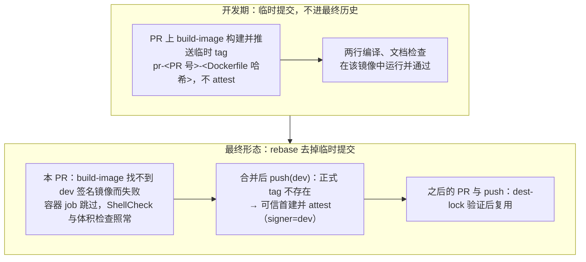
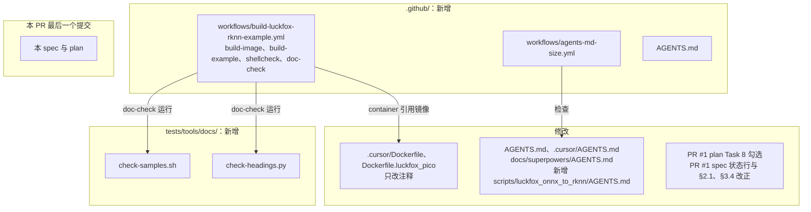
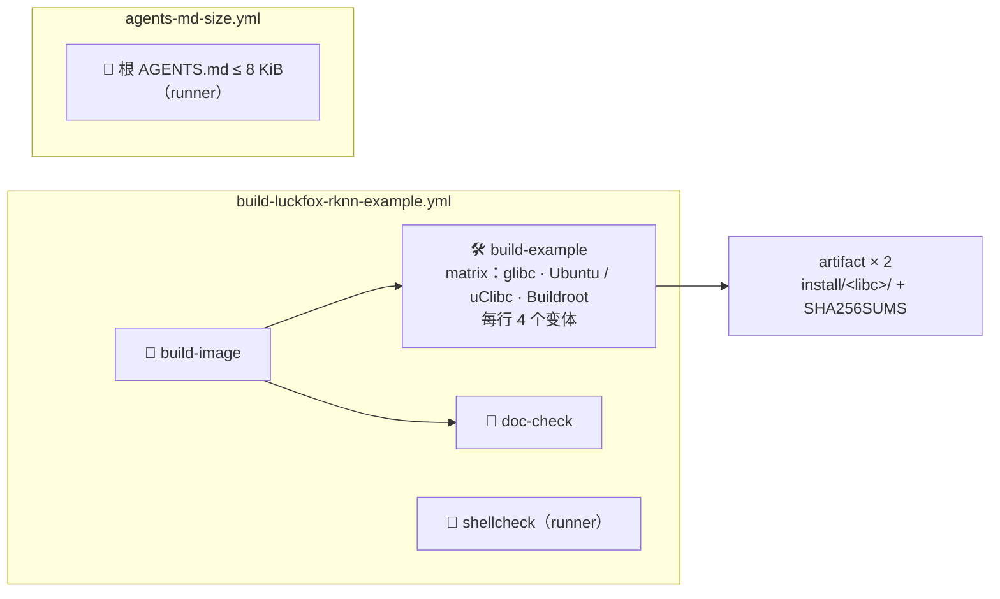

# Luckfox Pico RKNN Example — GitHub Actions CI 设计规格

- **日期**：2026-11-28
- **状态**：已落地，V1–V5、V7 通过，V6 待合并后在 `dev` 上核对，验证证据见 plan
- **分支**：`cursor/github-actions-ci-7892`（起点 `origin/dev` `1e5283e`，即 PR [#1](https://github.com/yuangezhizao/luckfox_pico_rknn_example/pull/1) 合入），开发期为草稿 PR
- **范围来源**：PR #1 spec [`2026-11-27-rknn-example-cloudagent-env-design.md`](2026-11-27-rknn-example-cloudagent-env-design.md) §7 路线图的第二项（两种 libc × 4 变体交叉编译、文档检查脚本入库与 job、`AGENTS.md` 体积检查）与该 spec Q1；PR #1 plan Task 8 的 V5、V6 在本 PR 的 Cloud Agent 中核对（§2.4）。作者要求参考 lvgl 仓 PR [#4](https://github.com/yuangezhizao/luckfox_pico_lvgl_example/pull/4)、[#12](https://github.com/yuangezhizao/luckfox_pico_lvgl_example/pull/12)、[#16](https://github.com/yuangezhizao/luckfox_pico_lvgl_example/pull/16)，luckfox-pico 仓 PR [#2](https://github.com/yuangezhizao/luckfox-pico/pull/2)、[#3](https://github.com/yuangezhizao/luckfox-pico/pull/3)、[#12](https://github.com/yuangezhizao/luckfox-pico/pull/12)，以及 rkmpi 仓 PR [#2](https://github.com/yuangezhizao/luckfox_pico_rkmpi_example/pull/2)，优先参考 rkmpi 仓（最新），代码以各仓最新 `dev` 为准
- **参考实现**：rkmpi 仓 [`dev` `cf2a0db`](https://github.com/yuangezhizao/luckfox_pico_rkmpi_example/tree/cf2a0dbb99416858454bef9f9108a028362e75d9)（PR #2 合入）的 `.github/` 与 `tests/tools/docs/`；其设计与取舍见 rkmpi 仓 CI spec [`2026-11-17-rkmpi-example-github-actions-ci-design.md`](https://github.com/yuangezhizao/luckfox_pico_rkmpi_example/blob/cf2a0dbb99416858454bef9f9108a028362e75d9/docs/superpowers/specs/2026-11-17-rkmpi-example-github-actions-ci-design.md)（下称 rkmpi CI spec）
- **关联计划**：[`../plans/2026-11-28-rknn-example-github-actions-ci.md`](../plans/2026-11-28-rknn-example-github-actions-ci.md)

---

## 1. 概述与目标

PR #1 补齐了 Cloud Agent 环境，但本仓仍没有 CI：交叉编译只在 Agent 或作者本机手动做，文档检查脚本要临时从 rkmpi 仓克隆，根 `AGENTS.md` 的 8 KiB 预算只是文字约定。rkmpi 仓与本仓同构（PR #1 spec §2.1），其 PR #2 已把 lvgl、luckfox-pico 两仓的 CI 做法移植并补上两处缺口（rkmpi CI spec Q19、Q21）；本 PR 以 rkmpi 仓 `dev` 为底移植，只改本仓的差异（§2.5）。

目标：

1. 交叉编译 workflow：以 `.cursor/Dockerfile` 构建 GHCR 镜像（digest 引用、provenance 签名与复用验证），在其中按两种 libc 交叉编译全部 4 个变体，做兼容性检查后上传 artifact（§3.3、§3.4）。
2. ShellCheck job（§3.5）。
3. 文档检查脚本 `check-headings.py`、`check-samples.sh` 入库，新增 `📝 文档检查` job（§3.6）。
4. 根 `AGENTS.md` 体积检查 workflow（§3.7）。
5. 新增 `.github/AGENTS.md`，更新根 `AGENTS.md`、`.cursor/AGENTS.md`、`docs/superpowers/AGENTS.md` 与两份 Dockerfile 注释中「暂无 CI」「脚本随 CI PR 入库」的说法；根文件为留在 8 KiB 内，「模型转换」一条移到 `scripts/luckfox_onnx_to_rknn/AGENTS.md`（§3.8、§3.9、Q6）。
6. 记录 PR #1 遗留的 V5、V6（§2.4），回填 PR #1 plan Task 8，并改正 PR #1 spec §2.1、§3.4 的 spidev 板型说明（§2.1.1）。

**不在本规格范围**：测试（qemu 加载冒烟、后处理单元测试、`build.sh` 行为测试等，候选同 rkmpi CI spec §2.7）；修改 `CMakeLists.txt`、`build.sh`、例程源码、`lib/`、`3rdparty/` 与 `install/`；模型转换（PR #1 spec Q3）；README 徽章与 Release。

## 2. 背景

### 2.1 本仓现状与实测（2026-11-28）

在本 Cloud Agent（`.cursor/Dockerfile` 的镜像，8 核）中执行，命令见 plan 附录 A。

| 方面 | 现状 |
|---|---|
| `.github/` | 不存在；`gh api repos/yuangezhizao/luckfox_pico_rknn_example/actions/workflows` 为 0 个 |
| 变体 | `build.sh` 的选项：`luckfox_pico_retinaface_facenet`、`luckfox_pico_retinaface_facenet_spidev`（必选板型 `LUCKFOX_PICO_PLUS` 或 `LUCKFOX_PICO_PRO_MAX`）、`luckfox_pico_yolov5`，每种 libc 4 个；已入库的 `install/<libc>/` 恰为这 4 个部署目录，没有不带板型的 `…_spidev_demo`；spidev 的板型与变体见 §2.1.1 |
| 部署目录 | 可执行文件、`lib/librga.so`（`3rdparty/CMakeLists.txt` 按 libc 安装的预编译库，与入库的逐字节相同）、`model/`（模型、标签、测试图）；`install/glibc/`、`install/uclibc/` 各 33 MB |
| 交叉编译 | 仓库外构建目录 + `make install DESTDIR=…`：两种 libc × 4 个变体全部成功，每个 1–3 秒，合计约 16 秒；工作区无改动 |
| 编译告警 | glibc 3 条 `-Wformat-overflow`（`retinaface_facenet` 与两个 spidev 变体的 `main.cc`，PR #1 spec §2.3），uClibc 0 条；根 `AGENTS.md` 规定告警只记录、不作门禁 |
| ABI（可执行文件） | glibc：interpreter `/lib/ld-linux-armhf.so.3`，`NEEDED` 为 `librknnmrt.so` `libstdc++.so.6` `libm.so.6` `libc.so.6` `ld-linux-armhf.so.3` `libgcc_s.so.1`，所需最高 `GLIBC_2.34`、`GLIBCXX_3.4.29`（yolov5，其余 3.4.21）、`CXXABI_1.3.9`、`GCC_3.5`；uClibc：interpreter `/lib/ld-uClibc.so.0`，`NEEDED` 有 `libc.so.0`；库搜索路径均为 `$ORIGIN/lib`，glibc 产物写在 `RUNPATH`（Ubuntu 的 binutils 默认 `--enable-new-dtags`），uClibc 产物写在 `RPATH`（SDK 的 GNU ld 保持上游默认 `--disable-new-dtags`），入库的两种二进制都是 `RPATH` |
| ABI（`librga.so`） | glibc 版 `NEEDED` 含 `libc.so.6`、`libpthread.so.0`，最高 `GLIBC_2.4`；uClibc 版 `NEEDED` 含 `libc.so.0`、`ld-uClibc.so.1` |
| 入库二进制 | 版本要求与 CI 产物相同；glibc 版另 `NEEDED libfunc_none.so`（`CMakeLists.txt` 链接了 `lib/glibc/libfunc_none.so`，入库二进制由 GCC 11.3.1 编译，未用 `--as-needed`；Ubuntu 24.04 的交叉工具链默认 `--as-needed`，产物不再依赖它） |
| uClibc 工具链 | 稀疏检出 `yuangezhizao/luckfox-pico` `dev`（`665c7f1`）的 `tools/linux/toolchain`，约 5 秒、321 MB |
| shell 脚本 | `git ls-files '*.sh'` 共 3 个：`.cursor/install.sh`、`.cursor/start.sh` 0 条；上游 `build.sh` 6 条（SC2086 info 5 条在第 3、66、67、69、70 行，SC2164 warning 1 条在第 70 行），与 rkmpi 仓的 `build.sh` 同类 |
| ShellCheck | 两份 Dockerfile 都不装 `shellcheck`（rkmpi、lvgl 仓相同），本 VM 临时 `apt-get install shellcheck`（0.9.0）；CI 的 ShellCheck job 用 runner 预装的版本 |
| 文档检查 | rkmpi 仓 `check-headings.py`（markdown-it-py 3.0.0）检查本仓 2 个文件，问题 0 处；PR #1 plan 含 `check-samples.sh` 的 `mk` 样例要替换的全部原文（`### Task 1：`、`### Task 2：`、`### Task 7：`、`（Task 7）`），PR #1 spec 含 `**Q2. ` |
| 根 `AGENTS.md` | 8,184 字节，距 8 KiB（8,192 字节）只剩 8 字节 |
| Actions 版本 | `actions/checkout` v7.0.1、`docker/login-action` v4.8.0、`actions/attest` v4.2.2、`actions/upload-artifact` v7.0.2，与 rkmpi 仓 `dev` 所用主版本相同 |

#### 2.1.1 spidev 的板型与变体（Q7）

`luckfox_pico_retinaface_facenet_spidev` 涉及两处判断，作用不同：

- **运行时**：`main.cc` 读 `/proc/device-tree/model`，型号为 Luckfox Pico Plus、Pro、Max 之一且存在 `/dev/spidev0.0` 时才点亮 SPI 屏，否则打印 `Screen OFF!`、只做推理。
- **编译时**：只有 `LUCKFOX_PICO_PLUS` 起作用，切换 `lib/Config/DEV_Config.h` 的 LCD、触摸与 SD 卡引脚和 `main.cc` 的 SPI 速率；`LUCKFOX_PICO_PRO_MAX` 在源码中未被引用，`CMakeLists.txt` 只用它决定安装目录名。

| 板子 | 运行时点亮 SPI 屏 | 编译变体（`build.sh` 的选项） | 引脚（DC / BL / TP_CS / TP_IRQ / SD_CS）、SPI 速率 | 部署目录 |
|---|---|---|---|---|
| Luckfox Pico Plus | 是 | `-DLUCKFOX_PICO_PLUS=ON` | 34 / 4 / 102 / 103 / 97，30 MHz | `…_spidev_plus_demo` |
| Luckfox Pico Pro | 是 | `-DLUCKFOX_PICO_PRO_MAX=ON` | 73 / 72 / 68 / 69 / 70，20 MHz | `…_spidev_pro_max_demo` |
| Luckfox Pico Max | 是 | `-DLUCKFOX_PICO_PRO_MAX=ON` | 同 Pro | `…_spidev_pro_max_demo` |
| 其他型号 | 否 | 无 | — | — |

即 3 款板子、2 种编译产物，CI 的两个变体已全部覆盖。不带板型的构建与 `PRO_MAX` 逐字节相同（实测见 plan §5.7），但会装到入库中不存在的 `…_spidev_demo`，不是发布变体。

比较产物时要知道 **GNU build-id**：链接器写入 ELF `.note.gnu.build-id` 节的唯一标识（`readelf -n` 可见，本仓 glibc 产物中位于偏移 `0x170`、36 字节），供 `gdb`、`debuginfod`、`-dbgsym` 包与崩溃转储把剥离过的二进制与其调试符号对上，不影响运行。Ubuntu 的 `arm-linux-gnueabihf-gcc` 默认传 `--build-id`（`gcc -dumpspecs` 的链接规则为 `%{!r:--build-id}`），算法为 SHA-1，摘要的是链接产物本身，所以内容相同则 build-id 相同、代码有差异则随之变化，不受构建目录影响；uClibc 的 SDK 工具链（gcc 8.3）不生成该节。因此 glibc 下 `PRO_MAX` 与不带板型连 build-id 在内相同，`PLUS` 的 build-id 与代码中的引脚、SPI 速率常量都不同。运行时只检查型号是否在三款之内，不检查编译时的板型是否与之匹配（§7）。

### 2.2 参考实现

lvgl 仓 `dev`（`11497f3`，2026-11-01）与 luckfox-pico 仓 `dev`（`665c7f1`，2026-11-03）在 rkmpi 仓 PR #2（2026-11-17 合并）之后没有新提交，rkmpi 仓 `dev` 已包含两仓的全部做法，另加两仓尚未同步的 dev 分支守卫（rkmpi CI spec Q19）与「只有 `pull_request` 取消旧 run」（同 Q21）。作者列出的参考 PR 在 rkmpi 仓中的落点：

| 参考 PR | 内容 | 在 rkmpi 仓 `dev` 中 |
|---|---|---|
| lvgl 仓 PR #4 | 首建 workflow：GHCR 镜像（Dockerfile 哈希为 tag）、provenance、dest-lock、两行 matrix | `build-image` 逐字保留，`build-example` 由 `build-demo` 改写 |
| lvgl 仓 PR #12 | 变体检验（mutation）job | 不适用（无单元测试） |
| lvgl 仓 PR #16 | 文档检查脚本入库与 `doc-check` job | `tests/tools/docs/`、`doc-check` |
| luckfox-pico 仓 PR #2、#3 | 固件 workflow 架构；provenance 复用验证、强制重建、`persist-credentials: false` | 已经由 lvgl 仓 PR #4 吸收 |
| luckfox-pico 仓 PR #12 | 月度重建后编译、run 摘要（事件名与分支名经 `env` 传入） | `schedule` 也运行 `build-example`、`doc-check`；`build-image` 写摘要 |

本 PR 逐文件的处理：

| rkmpi 仓文件 | 本仓处理 |
|---|---|
| `.github/workflows/build-luckfox-rkmpi-example.yml` | 改名为本仓；`build-image` 只改镜像名与 signer workflow；`build-example` 改为按变体清单构建（Q2），兼容性检查覆盖范围见 Q3；`shellcheck`、`doc-check` 照搬 |
| `.github/workflows/agents-md-size.yml` | 照搬，预算出处改为本仓 PR #1 spec |
| `.github/AGENTS.md` | 按本仓改写（§3.9） |
| `tests/tools/docs/check-headings.py` | 逐字复制（rkmpi 仓的版本已把出处写成 lvgl 仓的完整链接，`QA_EXEMPT` 为空） |
| `tests/tools/docs/check-samples.sh` | `mk` 样例改取本仓 PR #1 的 spec 与 plan（§3.6） |
| 两份 Dockerfile | rkmpi 仓 PR #2 取消注释 `python3-markdown-it`；本仓 PR #1 已启用（PR #1 spec Q2），只改注释（Q1） |

### 2.3 首个镜像从哪里来

与 rkmpi 仓 PR #2 相同（rkmpi CI spec §2.3）：最终形态下 `pull_request` 只复用 dev 签名的镜像，而本仓 GHCR 中还没有任何镜像，本 PR 的 `build-image` 必然失败，依赖它的容器 job 都被跳过。rkmpi 仓的镜像不能借用：tag 取 `.cursor/Dockerfile` 的内容哈希，本仓注释不同（本 PR 改注释后为 `92806b15…`，rkmpi 仓为 `703b5d91…`），dest-lock 也只信任本仓 `dev` 签发的 attestation。同 rkmpi CI spec Q2、Q14，开发期用临时提交在 runner 上验证：



### 2.4 PR #1 遗留的 V5、V6（2026-11-28）

本 Agent 是本 fork 合并 PR #1 后为它启动的 Cloud Agent，按 PR #1 plan Task 8 核对：

| 项 | 结果 |
|---|---|
| saved environment | `environment-info`：`source` 为 `Repository`，`recordedVia` 为 `REPO_FILE_OBSERVED`，`environmentJsonPath` 为 `.cursor/environment.json`，location 已自动指向该文件 |
| V5 Build | 两次手动 Build 均为 `SUCCEEDED`；本 Agent 启动自 `bld-20261127-9b54fc98-…`（2026-11-27 22:15–22:32，北京时间），日志中 `openssh-server` `1:9.6p1-3ubuntu13.20` 安装、`ssh-keygen` 生成 host key，末尾 `[INSTALL] Exit code: 0` |
| V6 用户与 grilling | `whoami` 为 `ubuntu`（uid 1000）；`~/.cursor` 为 `ubuntu:ubuntu 755`，`skills/`、`grilling/` 为 `750`，`SKILL.md` 为 `644`，SHA-256 `10ff989e…`，与 PR #1 plan §5.4 相同 |
| V6 Tailscale | 本机主机名 `cursor-agent-for-luckfox-pico-rknn-example-0c5c3bf0`（tailnet IP `100.109.254.116`）；`tailscale serve status` 有 1054、1055、5901；sshd 监听 22 |
| V6 构建 | 按根 `AGENTS.md` 的命令完成两种 libc × 4 个变体（§2.1） |
| V6 tailnet SSH | 作者 11-28 从另一台机器执行 `ssh ubuntu@cursor-agent-for-luckfox-pico-rknn-example-0c5c3bf0` 登录成功：本机 `last` 记录了 17:54、17:55 来自 `100.64.20.2` 的两次 `ubuntu` 登录，本机 ED25519 主机指纹为 `SHA256:Jg6gVjRbyfcRRysEnbJIBxCCPSe7JT1n64jNqBzIX28`。作者报告 `ssh root@…` 被拒；本机 `sshd -T` 为 `permitrootlogin no`、`passwordauthentication no`（公钥认证失败不写 btmp，本机也没有 sshd 的 syslog，只能核对配置） |

### 2.5 与 rkmpi 仓的差异

CI 相关的差异只有下面几处，其余（触发、并发、镜像、签名、ShellCheck、文档检查、体积检查）照搬：

- **变体不等于例程目录**：rkmpi 仓对 `example/` 下的每个目录构建一次；本仓 spidev 必须按两个板型各构建一次（§2.1.1），不带板型时会装到入库中不存在的 `…_spidev_demo`，所以需要显式的变体清单（Q2）。
- **部署目录带预编译库**：`lib/librga.so` 随部署目录上板、由动态链接器加载，rkmpi 仓的部署目录没有 `.so`（Q3）。
- **Dockerfile 不改包**：`python3-markdown-it` 在 PR #1 已启用，本 PR 只改注释（Q1）。
- **artifact 体积**：每行约 33 MB（模型为主），rkmpi 仓为几 MB；保留期仍用默认 90 天。

## 3. 设计（以 §8 QA 结论为准）

### 3.1 新增与修改的文件

作者判断「主要包含 `.github` 文件夹」成立：新增的主体是 `.github/` 下的两个 workflow 与 `.github/AGENTS.md`；另有 PR #1 spec Q1 定下随 CI PR 入库的两个检查脚本，以及几处说法的更新。



| 文件 | 新增 / 修改 | 说明 |
|---|---|---|
| `.github/workflows/build-luckfox-rknn-example.yml` | 新增 | 主 workflow（§3.2–§3.6） |
| `.github/workflows/agents-md-size.yml` | 新增 | §3.7 |
| `.github/AGENTS.md` | 新增 | CI 的 gotcha（§3.9） |
| `tests/tools/docs/check-headings.py`、`check-samples.sh` | 新增，可执行位 | §3.6 |
| `.cursor/Dockerfile`、`.cursor/Dockerfile.luckfox_pico` | 修改注释 | §3.8 |
| `AGENTS.md`、`.cursor/AGENTS.md`、`docs/superpowers/AGENTS.md` | 修改 | §3.9 |
| `scripts/luckfox_onnx_to_rknn/AGENTS.md` | 新增 | 根文件移出的「模型转换」（Q6） |
| PR #1 的 plan 与 spec（`2026-11-27-rknn-example-cloudagent-env*.md`） | 修改 | plan Task 8 勾选、spec 状态行改为 V5、V6 已通过，均指向本 spec §2.4；spec §2.1、§3.4 改正 spidev 板型说明（§2.1.1） |
| 本 spec 与 plan | 新增 | PR 的最后一个提交 |

### 3.2 workflow 结构与触发

触发、并发、权限与 rkmpi 仓相同（rkmpi CI spec §3.2）：`workflow_dispatch`（`force_rebuild`）、`schedule` `0 0 1 * *`（每月 1 日北京时间 08:00）、`push`（`dev`，`paths-ignore: '**.md'`）、`pull_request`（`dev`）；`concurrency.group` 含 `event_name`，只有 `pull_request` 取消同组旧 run；所有 job `runs-on: ubuntu-24.04`、按 job 设最小 `permissions`、`actions/checkout` 一律 `persist-credentials: false`；容器 job 以 `container.credentials` 拉取 digest，`options: --user 0`。



各事件下各 job 的行为同 rkmpi CI spec §3.2 的表。

### 3.3 `build-image`

以 rkmpi 仓的同名 job 为底，逐字保留 `assert_digest`、`dest_lock_or_die`、`require_dev`、按事件分流、buildx metadata 取 digest、run 摘要与新建时 `actions/attest@v4`，只改：

- 镜像名 `ghcr.io/<小写 owner>/luckfox-rknn-example-ci`；`--signer-workflow` 指向本 workflow 文件。
- 开头注释的出处改为「照搬 rkmpi 仓 `dev` `cf2a0db` 的同名 job（其底为 lvgl 仓 `11497f3`）」，「spec D12」「§9」仍指 lvgl 仓 PR #4 spec 的完整链接。
- `docker/login-action@v4` 照搬，以后四仓一起改为脚本内登录（Q4）。

### 3.4 `build-example`

- `needs: build-image`；`schedule` 也运行；`timeout-minutes: 30`；`permissions`：`contents: read`、`packages: read`。
- matrix 两行，`fail-fast: false`：`glibc · Ubuntu`（只设 `GLIBC_COMPILER=/usr/bin/arm-linux-gnueabihf-`）、`uClibc · Buildroot`（只设 `LUCKFOX_SDK_PATH` 为稀疏检出的 `yuangezhizao/luckfox-pico` `dev`，日志打印 SHA）。每行在一个 job 中依次构建 4 个变体（rkmpi CI spec Q3）。
- **变体清单**（Q2）：写在 job 级 `env` 的 `VARIANTS` 中，每行「例程 板型开关」，板型为空表示不传；构建与兼容性检查两步共用。构建前核对 `example/` 下的每个目录都出现在清单中，新增例程漏加时报错退出，不会被静默跳过。部署目录名按 `CMakeLists.txt` 的规则推出：`LUCKFOX_PICO_PLUS` 为 `_plus_demo`，`LUCKFOX_PICO_PRO_MAX` 为 `_pro_max_demo`，否则 `_demo`。

```text
VARIANTS: |
  luckfox_pico_retinaface_facenet
  luckfox_pico_retinaface_facenet_spidev LUCKFOX_PICO_PLUS
  luckfox_pico_retinaface_facenet_spidev LUCKFOX_PICO_PRO_MAX
  luckfox_pico_yolov5
```

- **构建**：先删除检出中的 `install/<libc>/`，再对每个变体 `cmake -S . -B build/<例程>[-<板型>] … [-D<板型>=ON]`、`make -j`、`make install`，使 `install/<libc>/` 只含本次的产物；某个变体失败时继续构建其余变体，最后列出失败的变体并以非 0 退出；每个变体的输出放在 `::group::` 中。CI 检出是一次性的，`make install` 改写其中已跟踪的 `install/` 不影响仓库。
- **兼容性检查**：沿用 rkmpi 仓的检查与四个上限（`GLIBC_2.35`、`GLIBCXX_3.4.30`、`CXXABI_1.3.13`、`GCC_7.0.0`，取自 Ubuntu 22.04 `jammy-updates` 的 armhf 包，依据与实测见 rkmpi CI spec §2.6），上限只用于 glibc 行，步骤名按行显示（rkmpi CI spec Q17）。本仓当前产物的最高要求都在上限内（§2.1）。对象（Q3）：每个部署目录的可执行文件查格式、interpreter、libc 与版本上限；`lib/*.so` 同样查格式、libc 与版本上限，共享库没有 interpreter，跳过这一项。
- **`SHA256SUMS`**：放在 `install/<libc>/` 中，递归覆盖全部文件（可执行文件、`lib/librga.so`、`model/`），按相对路径排序。
- **artifact**：每行一个，`install/<libc>/` 整个目录，名称 `luckfox_pico_rknn_example_<libc>-<rootfs>_on-ubuntu-24.04`，`if-no-files-found: error`，保留期默认 90 天。

### 3.5 `shellcheck`

照搬 rkmpi 仓：runner 上直接运行，不依赖 `build-image`，`schedule` 跳过；`shellcheck -x -P SCRIPTDIR`，默认级别（含 style），要求 0 条；文件列表为 `git ls-files -z '*.sh'` 去掉上游 `build.sh`（6 条，§2.1；同 rkmpi CI spec Q9、Q13，修复它的后续 PR 删去排除），即 `.cursor/install.sh`、`.cursor/start.sh`、`tests/tools/docs/check-samples.sh`。

### 3.6 文档检查脚本与 `doc-check`

- `tests/tools/docs/check-headings.py`：逐字复制 rkmpi 仓的文件（出处已是 lvgl 仓的完整链接，`QA_EXEMPT` 为空，本仓的 spec 都按 `**Q1. …` 写）。以后 lvgl 仓修改检查器时按 diff 同步三仓。
- `tests/tools/docs/check-samples.sh`：以 rkmpi 仓的文件为底，`mk` 样例改写的两份文档换成本仓 PR #1 的 spec 与 plan（`S1127`、`P1127`），要替换的原文在本仓文档中都存在（§2.1），样例写法与个数不变（115 个）；开头注释写明取用的两份文档。`mk` 在原文不存在时以 2 退出，以后修改 PR #1 的文档时样例会明确报错。
- `doc-check` job 照搬：容器 job，`needs: build-image`，依次运行 `python3 tests/tools/docs/check-headings.py` 与 `bash tests/tools/docs/check-samples.sh`，每次完整运行（rkmpi CI spec Q7）。

### 3.7 `agents-md-size.yml`

照搬 rkmpi 仓：单独的 workflow，`push`（`dev`）与 `pull_request`（`dev`）中改了根 `AGENTS.md` 时触发，runner 上运行，超过 8,192 字节时失败；预算出处改为本仓 PR #1 spec §3.4（其中写明沿用 rkmpi、lvgl 仓的 8 KiB），超限提示仍指向 lvgl 仓的放置原则。

### 3.8 两份 Dockerfile

只改注释，包行不变，非注释行仍与 rkmpi 仓逐字相同（Q1）：

- 「文档检查」组：改为「`tests/tools/docs/check-headings.py` 依赖 markdown-it-py；CI 的 `doc-check` job 在本镜像中运行它与 `check-samples.sh`」，去掉「暂用 rkmpi 仓的脚本」「随 CI PR 入库」。
- 分组总述中的 spec 指针加上本 spec，与 rkmpi 仓的写法相同。

注释改动使 `.cursor/Dockerfile` 的内容哈希变化；本仓还没有任何 CI 镜像，不影响复用。

### 3.9 `AGENTS.md`

按 lvgl 仓 PR #17 spec 的放置原则（[§3.1](https://github.com/yuangezhizao/luckfox_pico_lvgl_example/blob/11497f3d57d1e74eeade30a07e79a19c0f7f2369/docs/superpowers/specs/2026-11-01-lvgl-example-agents-md-slim-design.md)）与 rkmpi CI spec Q16 的结论：

- **`.github/AGENTS.md`**（新增）：结构与 rkmpi 仓相同（交叉编译、CI 镜像、各 job），内容改为本仓：4 个变体与 `VARIANTS` 清单（新增例程或板型时同步修改，漏加时 CI 报错）；部署目录含 `lib/librga.so`；CI 产物不依赖 `libfunc_none.so`、与入库二进制不逐字节相同，`install/` 仍只在作者要求时更新；真机才能验证摄像头、NPU 与屏幕；两份 Dockerfile 不装 `shellcheck`，本地检查前临时安装（Q5）。CI 镜像、dest-lock 恢复、排队与 schedule 的条目照搬。
- **根 `AGENTS.md`**：「测试与检查」改为 rkmpi 仓的写法：本仓暂无测试；ShellCheck「CI 要求 0 条」；改了 spec 或 plan 跑入库的 `check-headings.py`；加一条 CI 常识（触发范围、同一 PR 的新推送会取消 CI、改 `.cursor/Dockerfile` 的 PR 上 `build-image` 必然失败）；去向表加「改 workflow、排查 CI 失败 → `.github/AGENTS.md`」。根文件原只剩 8 字节：先压缩措辞（删去可由前半句推出的「没开 PR 的分支推送不触发」，spec 与 plan 的检查合并为一处写法，spidev 例程不再重复全名），再按 Q6 把「模型转换」一条整段移到新建的 `scripts/luckfox_onnx_to_rknn/AGENTS.md`（内容不删，另补 v6 模型的报错与 spec 指针），去向表「转换模型」一行指向它并保留「须用 RKNN-Toolkit2 1.6.0」；改后 8,192 字节。
- **`.cursor/AGENTS.md`**：「注释组」中指向根文件「模型转换」的一处改为指向 `scripts/luckfox_onnx_to_rknn/AGENTS.md`（Q6）；「CI」一条（原为「本仓暂无 CI」），同 rkmpi 仓改为指向 `.github/AGENTS.md`，写明镜像 tag 取 `.cursor/Dockerfile` 内容哈希、改它的 PR 上容器 job 被跳过；新增 apt 包时两份 Dockerfile 一并考虑的要求保留。
- **`docs/superpowers/AGENTS.md`**：「检查」一条改为 rkmpi 仓的写法：在仓库根目录运行入库的 `check-headings.py`，修改检查器时再运行 `check-samples.sh`，CI 的 `📝 文档检查` 运行两者；写明 `mk` 样例改写 PR #1 的 spec 与 plan，修改其原文时同步调整样例。

### 3.10 不做的事

- 不改 `CMakeLists.txt`、`build.sh`、例程源码、`lib/`、`include/`、`3rdparty/`、`utils/`、`install/`；`-Wformat-overflow`、死代码 `option`（PR #1 spec §2.3）不在本 PR 处理。
- 不在 CI 中运行 ARM 二进制；不比较 CI 产物与入库的二进制。
- 不 pin uClibc 工具链的提交（同 rkmpi CI spec Q20）。
- 不加 README 徽章、不发布 Release。

## 4. 验证

| 编号 | 验证 | 方式 |
|---|---|---|
| V1 | 静态检查 | `actionlint`（仓库外下载的二进制）对两个 workflow 0 条；§3.5 的文件列表 ShellCheck 0 条；`check-headings.py` 检查全部 spec 与 plan 为 0 处，`check-samples.sh` 不符合 0 个；根 `AGENTS.md` 不超过 8,192 字节；`check-headings.py` 与 rkmpi 仓逐字相同，`check-samples.sh`、`build-image`、`agents-md-size.yml` 与 rkmpi 仓只差预期部分 |
| V2 | 本机镜像 | 当前 VM 临时安装 Docker（`.cursor/AGENTS.md`「核对镜像内容」），构建两份镜像：两个文档检查脚本通过；在 `.cursor/Dockerfile` 的镜像中以 `--user 0` 原样执行 `build-example` 各步的 `run:`，两行 4 个变体都通过兼容性检查，`SHA256SUMS` 校验通过 |
| V3 | 门禁的反例 | 两套 libc 互查应失败；用调用 `sscanf` 的程序（`GLIBC_2.38`）替换一个变体的可执行文件应失败并列出符号；删去一个变体的可执行文件应失败；`VARIANTS` 漏掉一个例程时构建步骤应在编译前失败；把 uClibc 的 `librga.so` 放进 glibc 部署目录应失败 |
| V4 | 开发期 CI | 按 §2.3 的临时提交推送：全部 job 通过；两个 artifact 的文件清单与 `SHA256SUMS` 正确；另推一个改坏 spec 标题的临时提交，`📝 文档检查` 失败；run 编号记入 plan |
| V5 | 最终形态 CI | rebase 去掉临时提交后：`build-image` 因无 dev 签名镜像失败，容器 job 跳过；`🐚 ShellCheck` 与 `📏` 体积检查通过 |
| V6 | 合并后 | `push(dev)` 走可信首建并 attest；下一次 PR 走 dest-lock 复用。由下一个 PR 记录 |
| V7 | PR #1 的 V5、V6 | §2.4；tailnet SSH 由作者从另一台机器执行 |

## 5. 提交与 PR

- 分支 `cursor/github-actions-ci-7892`（`cursor/` 前缀区分 Cursor Cloud Agent 与 pi 开发的 `pi/` 分支），PR 指向 fork 的 `dev`，开发期为草稿；先推送 spec 与 plan，作者回答 grilling 后据此修订并实施。
- 提交按主题拆分（Dockerfile 注释、检查脚本、各 workflow、`AGENTS.md`），具体以 `git log` 为准；对 PR #1 plan 的回填与 PR #1 spec §2.1、§3.4 的改正合为单独一个提交；spec 与 plan 放在最后一个提交，开发期最先推送，最终用 rebase 移到末尾。
- §2.3 的临时提交只在开发期存在，验证后用 rebase 删去，运行记录见 plan。
- rebase、`--amend` 保留 author time；提交身份与 `Co-authored-by` 按根 `AGENTS.md`「Cursor Cloud specific instructions」。
- 合并前精简 plan，只保留未入库的内容：验证证据、偏离、合并后步骤与可复用的命令。

## 6. 风险

- **本 PR 的 CI 最终显示失败**：最终形态下 `build-image` 必然失败（§2.3），评审时以 V4 的 run 为准；合并后的 `push(dev)` 首建。
- **workflow 未启用**：GitHub 在 fork 中默认不运行 workflow，公开仓库的 fork 默认禁用 scheduled workflow，60 天无活动也会停用（[Disabling and enabling a workflow](https://docs.github.com/en/actions/how-tos/manage-workflow-runs/disable-and-enable-workflows)）。本仓首次推送后 workflow 即为 `active`（plan §5.4）；以后若被停用，PR 上不会出现检查，需要作者在 Actions 页或用 `gh workflow enable` 启用。
- **变体清单要人工维护**：新增例程漏加时 CI 报错（§3.4）；新增板型（如 spidev 以外的例程也需要板型）要同时改 `build.sh` 与 `VARIANTS`。
- **版本上限**：沿用 rkmpi 仓的取舍（rkmpi CI spec §6），板上 glibc 系统若不是 Ubuntu 22.04，按该系统的包调整。
- **第三方 Action**：`docker/login-action@v4` 是可变标签，运行在能推送并签名镜像的 job 中；GitHub 官方建议把 Action 固定到完整 commit SHA（[Secure use reference](https://docs.github.com/en/actions/reference/security/secure-use)）；与 rkmpi 仓一样暂时接受，四仓一起去掉它（Q4）。
- **根 `AGENTS.md` 已无余量**：改后正好 8,192 字节（§3.9），任何新增都会让体积检查失败；先按放置原则把不是每个任务都需要的内容移到子目录 `AGENTS.md`，再考虑调整预算。
- **临时 tag 留在 GHCR**：§2.3 的 `pr-…` tag 不被复用路径信任，合并后可在包页面删除。

## 7. 后续

- `build.sh`：修复 6 条 ShellCheck 并加行为测试，ShellCheck job 删去排除（同 rkmpi CI spec §7）。
- qemu 加载冒烟、后处理原生单元测试（PR #1 spec §7）。
- 合并后核对 V6（§4），记入下一个 PR。
- spidev 例程运行时只检查型号是否为 Plus、Pro、Max 之一，不检查编译时的板型是否与之匹配，`_plus_demo` 放到 Pro 上会点亮屏幕但引脚不对（§2.1.1）；随修改例程的 PR 处理。
- 跨仓：三仓 `build-image` 去掉 `docker/login-action`（rkmpi CI spec Q22，本仓加入，四仓一起改，Q4）；lvgl、luckfox-pico 两仓同步 dev 分支守卫与 `cancel-in-progress`（rkmpi CI spec §7）。

## 8. QA（grilling 记录）

问句与推荐取自问答原文，「答」是作者回答经润色后的版本。只记录设计决策与约束澄清，命名、验证方式、提交拆法等能从代码与 git 历史直接看出的问答不在此记录。Q1–Q5 于 11-28 第 1 轮提出，均按推荐；Q6 由实施中根 `AGENTS.md` 超出预算引出；Q7 由作者复查时提问引出。

**Q1. PR 范围**

- 问：A 对齐 rkmpi 仓 PR #2：主 workflow（`build-image`、`build-example`、`shellcheck`、`doc-check`）、体积检查 workflow、检查脚本入库、四份 `AGENTS.md`，两份 Dockerfile 只改「文档检查」组的注释（包行在 PR #1 已启用）；B 在 A 之外同时做 qemu 加载冒烟（取消注释 `qemu-user`）；C 在 A 之外修复 `build.sh` 的 6 条 ShellCheck。
- 推荐：A。与 PR #1 spec §7 路线图中这一个 PR 的范围相同；B 只证明加载、不证明功能，C 要配行为测试，都单独一个 PR（rkmpi CI spec Q1、Q9）。注释改动使 Dockerfile 哈希变化，本仓还没有镜像，没有额外成本。
- 答：按推荐 A（§1、§3.8）。

**Q2. 变体清单**

- 问：spidev 要按两个板型各构建一次（§2.5）。A 在 workflow 的 job 级 `env` 中写 4 行变体清单（同 `build.sh` 的选项），构建前核对 `example/` 下的每个目录都在清单中，漏加即失败；B 遍历 `example/` 目录，对源码中出现 `LUCKFOX_PICO_PLUS` 的例程自动构建两个板型；C 以入库的 `install/<libc>/` 下的部署目录名反推变体。
- 推荐：A。清单与 `build.sh` 一一对应，评审时一眼可见；核对步骤保证新增例程不会被静默漏掉。B 依赖源码中的宏名约定（`lib/Config/DEV_Config.h` 也用这个宏，所有例程都会编进去），C 把发布产物当成构建配置，删改 `install/` 会改变 CI 的行为。
- 答：按推荐 A（§3.4）。

**Q3. 兼容性检查是否覆盖 `lib/librga.so`**

- 问：部署目录中的 `lib/librga.so` 是 `3rdparty/` 中按 libc 预编译的库，随例程上板、由动态链接器加载（§2.1）。A 同 rkmpi 仓，只查可执行文件；B 对 `lib/*.so` 也做格式、libc 与 glibc 版本上限检查（共享库没有 interpreter，不查这一项）。
- 推荐：B。检查代码相同，只跳过 interpreter；以后更新 `3rdparty/` 时放错 libc 或架构的库（如把 `armhf_uclibc` 的库装进 glibc 部署目录）会在 CI 中报出，而不是板上报 `cannot open shared object file` 或版本错误。当前两版 `librga.so` 都符合（glibc 版最高 `GLIBC_2.4`）。
- 答：按推荐 B（§3.4）。

**Q4. `docker/login-action` 是否在本 PR 去掉**

- 问：rkmpi CI spec Q22 认定 `docker/login-action@v4` 是 workflow 中唯一的第三方 Action、运行在权限最高的 job 中，决定「以后三仓一起改为脚本内 `docker login --password-stdin`」，目前三仓都未改。A 本仓与 rkmpi 仓保持一致，照搬 `@v4`，以后四仓一起改；B 本 PR 直接改为脚本内登录（`printf '%s' "$GH_TOKEN" | docker login ghcr.io -u "$ACTOR" --password-stdin`），本仓先行，`build-image` 与 rkmpi 仓多一处差异。
- 推荐：A。`build-image` 与 rkmpi 仓只差镜像名与 signer workflow，同步时用一条 diff 即可核对（V1）；该风险已在 rkmpi 仓接受，四仓一起改时一次验证。B 的改动本身只有几行，若作者想借本仓先验证改法，也可以选 B。
- 答：按推荐 A，以后四仓一起改（§7）。Codex 安全审查在本 PR 提出同一建议（[P2](https://github.com/yuangezhizao/luckfox_pico_rknn_example/pull/2#discussion_r4726796320)：钉到完整 SHA 或改用 `docker login --password-stdin`），作者维持本结论，在评论线程中回复以后的改法，不标记解决。

**Q5. Dockerfile 是否加装 `shellcheck`**

- 问：根 `AGENTS.md` 要求改 shell 脚本时本地跑 ShellCheck，但两份 Dockerfile 都不装它（rkmpi、lvgl 仓相同），本 VM 是临时 `apt-get install` 的（§2.1）。A 不加，CI 的 ShellCheck job 用 runner 预装的版本，本地需要时临时安装；B 两份 Dockerfile 加 `shellcheck`，本仓的非注释行与 rkmpi 仓出现差异，最好四仓一起加。
- 推荐：A。本 PR 的 ShellCheck 门禁在 runner 上，镜像加包不影响 CI；改 shell 脚本的任务不多，临时安装只需几秒；「四仓 Dockerfile 非注释行相同」便于同步。若作者希望 Agent 开箱即用，选 B 并记为四仓后续。
- 答：按推荐 A。

**Q6. 根 `AGENTS.md` 超出 8 KiB 时移走哪部分**

- 问：按 §3.9 改写「测试与检查」、去向表加一行后为 8,610 字节；只压缩措辞、不删信息（删去「没开 PR 的分支推送不触发」这句可由前半句推出的话，spec 与 plan 的检查合并为一处写法，spidev 例程名不再重复全名）后仍为 8,503 字节，超出 311 字节，剩下的只能移走整段内容或放宽预算。A 把「模型转换」一条（316 字节）移到新建的 `scripts/luckfox_onnx_to_rknn/AGENTS.md`，根去向表「转换模型」一行改为指向它并在行内保留「只能用 RKNN-Toolkit2 1.6.0」，`.cursor/AGENTS.md` 中指向根文件「模型转换」的一处同步，改后约 8,150–8,190 字节；B 根文件「CI」一条删去「修改 `.cursor/Dockerfile` 的 PR 上 `build-image` 必然失败」（100 字节，`.cursor/AGENTS.md`、`.github/AGENTS.md` 都写了），再压缩「优先级」一条中与去向表重复的 `docs/superpowers/AGENTS.md` 链接，仍不够时与 C 合用；C 本仓的预算放宽到 9 KiB（9,216 字节），与 rkmpi、lvgl 仓的 8 KiB 不同。
- 推荐：A。按放置原则（lvgl 仓 PR #17 spec §3.1），根文件只写几乎每个任务都用得到的内容；模型转换只在换模型时用到（PR #1 spec §2.7「本仓日常改动用不到」），正是应移到子目录的一类，而 B 删去的是 rkmpi CI spec Q16 认定所有任务都要知道的 CI 常识。去向表一行保留「1.6.0」，Agent 不进该目录也能看到最关键的约束；子目录文件写完整的原因（PyPI 只有 2.x、Python ≤ 3.11、镜像不预装）。
- 答：按推荐 A（§3.9）。

**Q7. spidev 到底有几个变体**

- 问：作者看到 spidev 的 `main.cc` 判断 Luckfox Pico Plus、Pro、Max 三款板子，问到底有几个变体，以及 PR #1 spec §2.1 中「板型只影响 SPI 速率」是否准确。
- 答：3 款板子、2 种编译产物，CI 的两个变体已全部覆盖；Plus 还切换引脚，PR #1 spec §2.1、§3.4 改正。依据与对比表见 §2.1.1。
